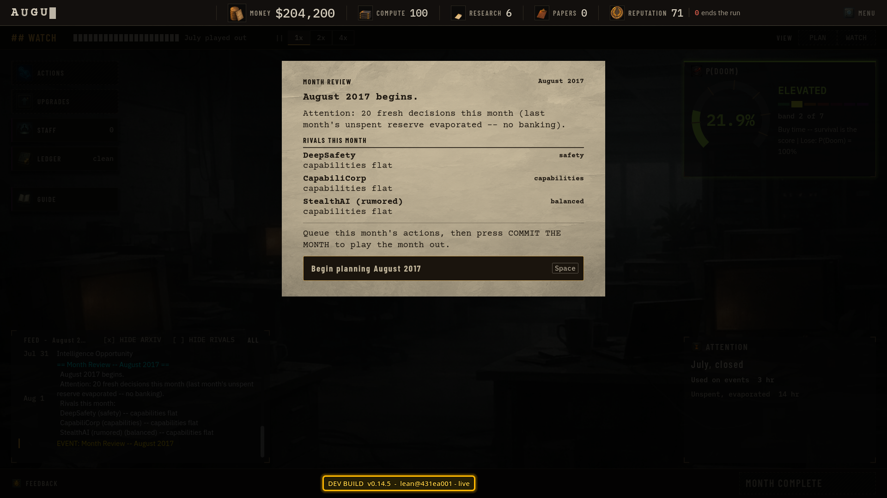
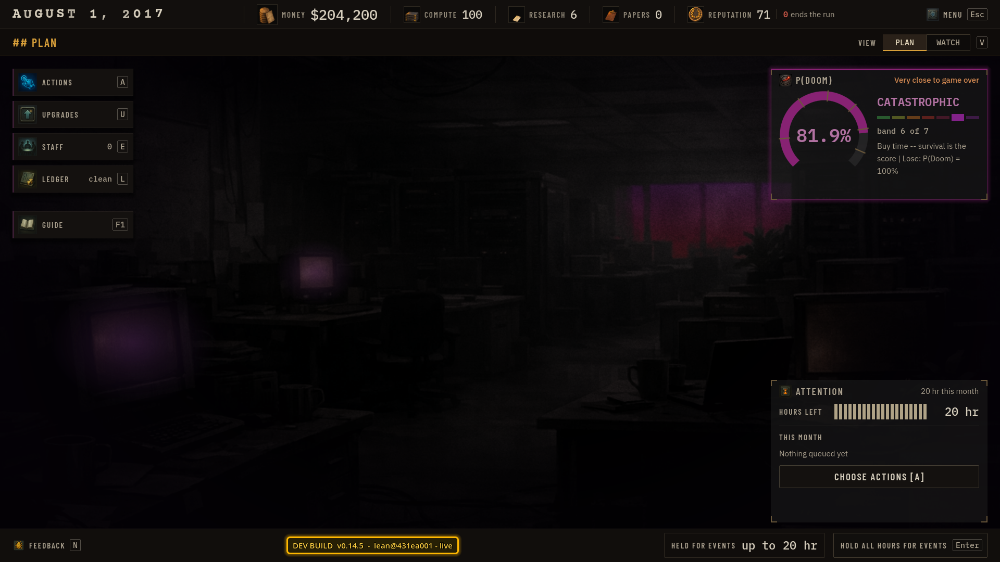

### Problem or Motivation

_Filed by Claude (an AI agent) on behalf of @SwitchOCE (Alex)._

**In short.** Alex's fork has a second, optional layout for the main screen, the G desk,
built and playable on your v0.14.5. It does not change a single rule. We would like to
know whether you want it, and if so how it should sit beside your skins (#1372), before
we open a PR. Alex can send you a Windows build (`PDoom-G-desk-431ea001.zip`, 97 MB; see
"How to try it" below). Your CONTRIBUTING.md asks for an issue before significant work;
this is that issue, a little late, and nothing goes to your repo unless you say yes.

**The problem, as a player meets it.** Alex found month 1 hard to read. The first screen
shows about 15 icon tiles, the upgrades list, the action queue and a string of readouts at
once, all at one weight, before the player knows what any of them do (screenshot 1 below).
The game does point the way: the advisor line ("you do not know anything yet. Go and find
out -- scouting (the glowing button)") and the glow on the Scouting tile. Alex found that
hint easy to miss among everything else. G keeps the same hint and makes it the most
prominent thing on screen: a note with an arrow to the Actions plate.

### Proposed Solution

#### What G is

G is a second layout of the same main screen. Five plates on the left (Actions, Upgrades,
Staff, Ledger, Guide) open one sheet at a time; the P(Doom) card and the hours left are
always shown; resources sit in one strip across the top with a small tier icon each;
Commit sits bottom right. Events, the month review and the advisor note arrive as paper on
the desk. While the month plays (WATCH), G says which workday it is, how many hours are
still held for events, and folds busy days in the feed. The office backdrop darkens with
the doom band, and each new month's date types itself in (with a typewriter sound that can
be muted). It reads and writes the same game state through the same handlers as classic:
it is a view, not a new rule set.

Screenshots (1920x1080 CPU renders from the test fixture, so the debug "DEV BUILD" badge
shows; a release export shows only a small version label):

1. Classic, month 1 (today's screen, same build with G off):
   
2. G, month 1:
   

<details><summary>Five more: the Actions sheet, the plan, WATCH with an event, the review, doom band 6</summary>

3. G, the Actions sheet:
   
4. G, the plan for the month:
   
5. G, WATCH with an event:
   
6. G, the month review (the date is typing in):
   
7. G, doom band 6 of 7:
   

</details>

#### How to try it

`PDoom-G-desk-431ea001.zip` holds PDoom.exe + PDoom.pck exported from `431ea001` with
Godot 4.5.1, "Windows Desktop", release mode, plus a README and a .bat.

- **Start with `play-separate-profile.bat`.** It runs the game with its own profile
  folder next to the exe by setting APPDATA for that one run (your
  `scripts/run_godot_tests.py`: "Only APPDATA works on Windows"). Tested on Windows 11:
  the game's user folder is created next to the exe and the normal profile is untouched.
- **PDoom.exe on its own uses your normal profile**, `%APPDATA%\Godot\app_userdata\P(Doom)`:
  the project name is unchanged and there is no custom user dir
  (`grep -n "config/name\|custom_user_dir" godot/project.godot`). It adds one file,
  `g_ui.cfg`; settings or saves from 0.15.0 may not load cleanly in it.
- G starts on. To switch it off: Settings > ALL PROTOCOLS > G desk
  options > "G desk (the new main screen)" off. That restores the saved layout, which
  defaults to classic, the next time the game screen opens (New Game or Continue).
- A fresh profile sends your anonymous launch ping on its first start, because it is on
  by default (`godot/autoload/game_config.gd:134`). Turn it off in Settings > ALL
  PROTOCOLS > "Anonymous launch ping".
- It is built on 0.14.5. It has had a text merge only against your main at 9ef96f64
  (v0.15.0); it has not been booted or tested on 0.15.0, alone or with skins.

#### What it changes in your code

The commands run in a clone of the fork:

```
git clone https://github.com/SwitchOCE/pdoom1 pdoom1-g && cd pdoom1-g
git checkout d92044fb        # build E's code (431ea001) + one fork script, same_seed.sh
git fetch https://github.com/PipFoweraker/pdoom1 main   # for the merge row
```

`4119ddcb` is your main at v0.14.5, the base of the work; `431ea001` is the code of the
build.

| Claim | Command |
|---|---|
| **16 commits, each one step of G** | `git log --oneline 4119ddcb..431ea001 -- godot` |
| **218 files, +18,778 / -23 lines** | `git diff --shortstat 4119ddcb 431ea001 -- godot` |
| **17 of your files edited, nothing deleted** | `git diff --name-status 4119ddcb 431ea001 -- godot \| grep -v '^A'` |
| **No change to game data or game logic** | `git diff --stat 4119ddcb 431ea001 -- godot/data godot/scripts/core godot/scripts/game_manager.gd` prints nothing |
| **Month 1 of seed g-parity-1, on one input path, ends the same in classic, in G and in 4119ddcb** | "Same seed" below |
| **1755 tests, 0 failures; 222 new test functions** | `python scripts/run_godot_tests.py --quick --ci-mode --min-tests 300`; `git diff 4119ddcb 431ea001 -- godot/tests \| grep -c '^+func test_'` |
| **Ladder-Impact: none; the tripwire lists `keybind_manager.gd` and `theme_manager.gd`, both additive** | `python tools/check_ladder_bump.py --base 4119ddcb --head 431ea001` |
| **Text merge only against 9ef96f64 (v0.15.0), no conflicts; not booted or tested on 0.15.0, alone or with skins** | `git merge-tree --write-tree 9ef96f64 431ea001` exits 0 |

<details><summary>Your 17 files that G edits, with lines added/removed</summary>

From `git diff --numstat 4119ddcb 431ea001 -- <file>`:

- `scripts/ui/main_ui.gd` +116/-12 -- mounts the desk, reads `g_ui.cfg` at boot, hands
  the desk the live state; classic paths unchanged.
- `scripts/ui/layout_controller.gd` +199/-3 -- a third layout, `g`, beside classic and
  proposed: hides the classic chrome, moves a few of your nodes onto the desk, puts them
  back on leaving.
- `scripts/ui/month_review_panel.gd` +165/-1, `event_dialog.gd` +64/-1 -- the paper skin,
  asked for only when the layout is `g`; the buttons, keys, order and handlers are today's.
- `scripts/ui/dev_build_badge.gd` +54/-1 -- lets a layout dock the badge elsewhere (G puts
  it in its bottom strip; it covered G's MENU plate).
- `ledger_screen.gd` +24, `research_quality_selector.gd` +22/-1, `player_guide.gd` +20/-1
  (the guide can open as an overlay over a live run), `submenu_controller.gd` +14/-1,
  `action_bar_renderer.gd` +13/-2, `settings_menu.gd` +14 and `scenes/settings_menu.tscn`
  +16 (the "G desk options" button), `event_result_presenter.gd` +4.
- `autoload/keybind_manager.gd` +12 -- six binds read only while G is on (A, U, E, Q, R,
  F1); a saved bind on the same key wins.
- `autoload/theme_manager.gd` +4 -- one new font step, `label` (body + 3 px), between body
  and header; no existing step moves.
- Tests: `test_ui_layout.gd` +216, `test_font_size_ssot.gd` +5.

</details>

New files (`git diff --name-status --diff-filter=A 4119ddcb 431ea001 -- godot`): 23
scripts in `scripts/ui/g/` (7,496 lines of .gd, plus their 23 one-line .uid sidecars), 5
scenes, `theme/g_theme.tres`, one shader (the room), 14 unit test files and the capture
fixture `tests/visual/g_capture.gd`, and the media and fonts below (3.5 MB).

**Same seed.** What was checked: month 1 of seed `g-parity-1`, played along one input path
(three Scouting picks by mouse, Commit, the first option of each event, the review), ends
in the same game state -- the sha256 of `GameManager.state.to_dict()` at the start of
month 2 -- in classic, in G, and in your 0.14.5 base `4119ddcb`. The fixture is
`tests/visual/g_capture.tscn`; each run is a fresh process with an empty profile. Set
`GODOT` to your Godot 4.5.1 binary first, with the one line for your system.

Windows (Git Bash):

```
export GODOT="C:/Users/you/tools/godot-4.5.1/Godot_v4.5.1-stable_win64_console.exe"
```

Linux:

```
export GODOT="$HOME/tools/Godot_v4.5.1-stable_linux.x86_64"
```

Then, on either:

```
export GODOT_BIN="$GODOT"   # tools/check_class_cache.py, which the script runs first, reads this
bash fork/design/godot-g/tools/same_seed.sh                          # classic and G
git worktree add ../pdoom1-base 4119ddcb                             # today's game
mkdir -p ../pdoom1-base/godot/tests/visual
cp godot/tests/visual/g_capture.gd godot/tests/visual/g_capture.tscn ../pdoom1-base/godot/tests/visual/
(cd ../pdoom1-base && bash ../pdoom1-g/fork/design/godot-g/tools/same_seed.sh classic)
```

Pass rule: each run's line shows `G_CAPTURE result PASS`, and the three `HASH` lines are
present and equal. On 2026-11-23 (Linux, Godot 4.5.1) all three printed
`d732161daf4066d4f1bf66cd9de61259cc91bc84d0d764d4156c467a49eab8ea`. The script is written
for Git Bash too but has not been run on Windows. To save the fixture's screenshots instead,
under its own file names (`classic-01_month1.png`, `g-01_month1.png`, ...; the seven above
are renamed copies), give an absolute output folder whose path has no spaces (the script
splits it on spaces):

```
MODE=shots OUT="$HOME/g-shots" bash fork/design/godot-g/tools/same_seed.sh
```

**The PR would ship G off.** The fork has G on by default for Alex's playtests
(`grep -n DESK_DEFAULT godot/scripts/ui/g/g_prefs.gd`); for your repo it would be off, the
way #1372 kept "Default is unchanged", so nobody sees G unless they switch it on.

#### What it does not do

- No new teaching. The tutorial is today's: the advisor line is your existing first-lever
  hint, shown in G as a note, plus one line G adds saying which plate holds it ("Scouting is
  in Actions, the glowing button."); the Player Guide is your guide, opened as an overlay.
- No hidden information made visible (ADR-0001, ADR-0015): each tier icon restates the
  number beside it, the optional resource traces (off unless chosen in G options) plot
  month-start amounts the strip has already shown, and the feed line that prints a doom
  change in numbers is hidden in G (classic keeps it). Each step was reviewed for this.
- G hides OfficeFloor (WATCH's office view) and OfficeCat while it is on; classic keeps
  both.
- Classic changes only in these ways:
  - the "G desk options" button on the Settings ALL PROTOCOLS board;
  - six "(G desk)" rows in the keybindings list (inert in classic);
  - the debug-only F9 layout cycle now includes `g` (classic -> proposed -> g -> classic);
  - switching G off restores the saved layout (classic unless you chose proposed).

#### Art and audio

From the fork's provenance file (`fork/design/godot-g/provenance.json`, 44 records in your
manifest's format; count them with
`python -c "import json,collections;print(collections.Counter(r['origin'] for r in json.load(open('fork/design/godot-g/provenance.json'))['assets'].values()))"`):

- **32 images from an image model** (`generated_model`): 25 resource tier icons, 6 action
  icons, the paper sheet. They are prototype / placeholder art (see #1015), made with the
  Codex built-in image tool. The prompts are in the fork on branch `design/ui-concepts`:
  `fork/design/godot-g/upstream/prompts/` and `fork/design/godot-g/art-trial-prompt.txt`;
  each record names its prompt, its source image's sha256 and the script that cut it.
- **7 typewriter sounds**, synthesized by a NumPy script
  (`fork/design/godot-g/tools/synthesize.py`), recorded as `procedural_render`.
- **5 textures rendered by scripts** (`panel_grime_9`, `hatch_16`, `room_window_mask`,
  `room_noise_lo`, `room_noise_hi`), recorded as `procedural_render`. Two of them are
  derived from your own images (5% of `tex_painted_metal_panel_512.png`; a mask traced
  from `office_wide_day.webp`).
- **4 fonts under the SIL Open Font License**: Barlow Condensed, Courier Prime, IBM Plex
  Mono, IBM Plex Sans (`ls godot/assets/fonts/*/OFL.txt`).

**The Manifund question.** Your `tools/assets/check_provenance.py` treats a
`procedural_render` image as non-model (`NON_MODEL`, line 94) and shouts MANIFUND TRIGGER
when one ships. Your manifest has none today, so G's 5 textures would be the first (from
reading the checker and your manifest; we have not merged the records and run it). Alex's
view: "The script was AI written. They are AI generated right?" -- every one of those
scripts was written by an AI agent. We have still recorded them as script-rendered, not as
`generated_model`. Whether they count as AI-generated for the grant wording is your call
(it is the question in #1257); the sounds are audio, so the checker does not count them.

All of G's look -- icons, paper, textures, fonts, sounds -- sits in separate files with
records, so your human designer can replace any of it without touching the layout code.

#### Size and the PR we would send

About 19k lines, of which about 6.7k are tests and the capture fixture
(`git diff --shortstat 4119ddcb 431ea001 -- godot/tests`).

Proposed shape: **one PR, "all of G at once"**, rebased onto your main, with the 16 commits
kept as review units (desk, WATCH, look, paper, room, dateline, tier icons, traces,
motion, then the small fixes). If you would rather have it in pieces, we will split it
along those commits.

<details><summary>What we would add for your process before opening it</summary>

- the 44 records merged into `godot/data/asset_provenance.json`;
- the 4 fonts in `CREDITS.md`;
- the art and capture tools moved to `tools/`, with entries in `docs/TOOLS.md`;
- a G section in `godot/UI_STYLE_GUIDE.md`;
- the fork-only references removed: 54 mentions of `fork/design/godot-g/...` in 50 files
  (`git grep -c 'fork/design/godot-g' 431ea001 -- godot`) and the "Alex's Q1/Q2" comments
  (`git grep -n "Alex" 431ea001 -- godot/scripts/ui/g`);
- G off by default;
- rebased onto 0.15.0, booted there with and without skins, with the fast gate, your
  guards and the same-seed check run again there, plus `Ladder-Impact: none -- ...` in the
  message.

</details>

#### Questions for you

1. Do you want G in your repo at all, as an optional layout that ships off?
2. Skins and G: which of the options under "Alternatives Considered", or something else?
3. Do the 5 script-rendered textures (scripts written by AI) count as AI-generated for the
   Manifund wording, or should they wait for #1257 -- or be replaced?
4. One PR with 16 review commits, or split?
5. The six G-only key binds and the badge docking in `dev_build_badge.gd`: fine as they
   are?
6. Anything in G's look you would rather your designer owns from the start?

Bugs found while building G, filed separately: #1377 #1378 #1379 #1380 #1381 #1382 #1383
#1384 #1385.

The build log, the spec G was built from and the reviews are in the fork on branch
`design/ui-concepts` under `fork/design/godot-g/` (start with `build-report.md`).

### Alternatives Considered

**How G sits beside your skins (#1372).** Skins recolour today's layout; G is a different
layout with its own theme. They have not been run together (G is built on 0.14.5). Your
call:

- (a) keep them apart: skins in the theme dropdown, G as its own switch, as now;
- (b) list G in the skin dropdown as one more entry that also switches the layout;
- (c) have G take its colours from the active skin, so "Paperwork (Alex C)" and the others
  recolour G too.

**The terminal look (#529, unparked 2026-10-26, PR #1350).** G leaves the separate #529
CRT package available for future work. G's look is a desk in the office rather than a
terminal.

**The office as a visual loop (#1319).** G grades only the static office backdrop by doom
band. It does not address OfficeFloor's tiers or furniture, and it hides OfficeFloor while
G is on.

**Fixing classic in place instead.** The classic display bugs filed above can be fixed one
at a time, but that does not change how much month 1 shows at once, which is the problem
above.

### Category

User Interface

### Contribution

- [x] I would be willing to implement this feature
